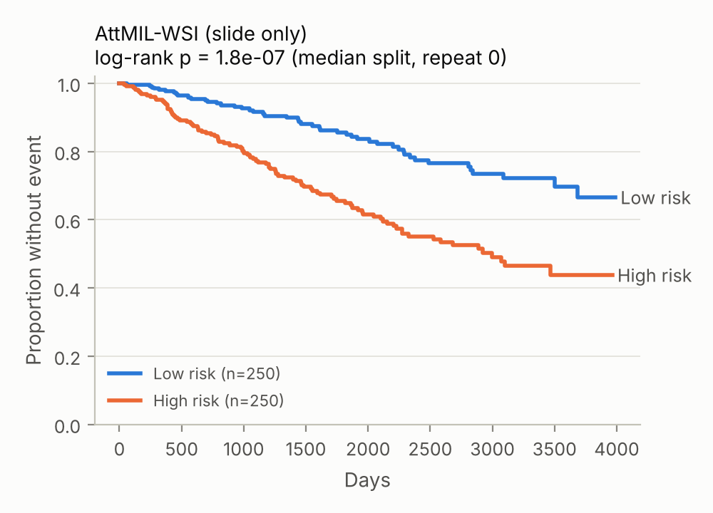
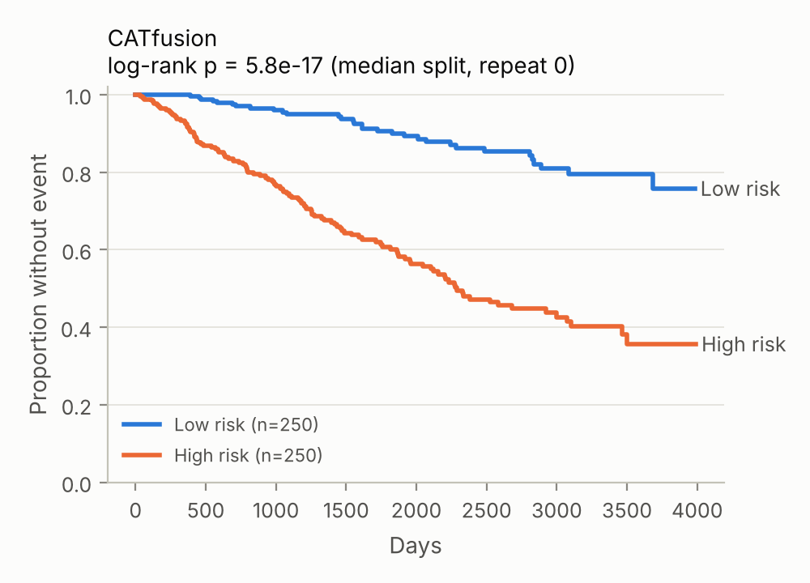
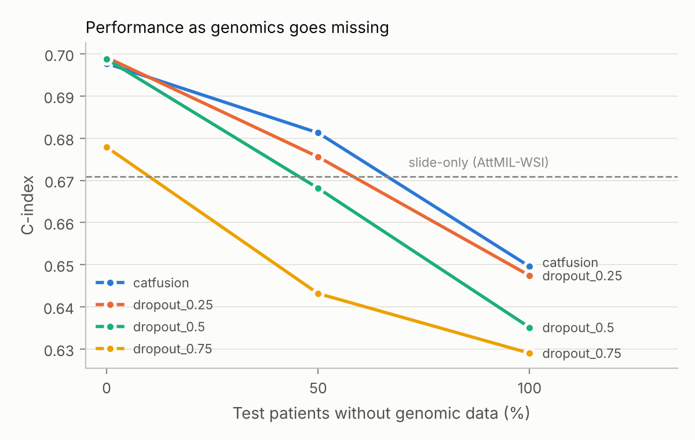

# Results

**Synthetic data.** These numbers test the code path only; they are not TCGA results and are not comparable to the paper. One repeat of 5-fold CV, tiny model (hidden 64, 2 cross + 1 self block), 25 epochs, lr 3e-4, weight decay 1e-4, released-code model selection and Cox loss unless the run name says otherwise.

## C-index and survival AUC

C-index: aggregated out-of-fold predictions, mean ± SD over repeats of 5-fold CV (the paper's reporting; no SD with a single repeat). Per-fold: mean ± SD of the five test-fold C-indices. Survival AUC: Uno's cumulative/dynamic AUC, mean ± SD over folds.

| Run | Test missingness | n (events) | C-index | Per-fold C-index | Published (BRCA) | Survival AUC | Log-rank p (median) |
|---|---|---|---|---|---|---|---|
| attmil_genomic | 0% | 500 (147) | 0.610 | 0.679 ± 0.028 | – | 0.694 ± 0.027 | 1.1e-05 |
| attmil_wsi | 0% | 500 (147) | 0.671 | 0.686 ± 0.039 | – | 0.706 ± 0.043 | 1.8e-07 |
| catfusion | 0% | 500 (147) | 0.698 | 0.743 ± 0.042 | – | 0.767 ± 0.050 | 5.8e-17 |
| catfusion | 50% | 500 (147) | 0.681 | 0.718 ± 0.057 | – | 0.737 ± 0.078 | 4.2e-11 |
| catfusion | 100% | 500 (147) | 0.650 | 0.681 ± 0.015 | – | 0.703 ± 0.033 | 1.1e-06 |
| cox_clinical | 0% | 500 (147) | 0.670 | 0.672 ± 0.029 | – | 0.696 ± 0.030 | 1.5e-07 |
| distill_0.25 | 0% | 500 (147) | 0.640 | 0.684 ± 0.042 | – | 0.705 ± 0.041 | 6.6e-06 |
| distill_0.5 | 0% | 500 (147) | 0.637 | 0.683 ± 0.036 | – | 0.706 ± 0.035 | 5.7e-06 |
| distill_0.75 | 0% | 500 (147) | 0.629 | 0.682 ± 0.035 | – | 0.703 ± 0.035 | 0.00012 |
| dropout_0.25 | 0% | 500 (147) | 0.699 | 0.725 ± 0.037 | – | 0.752 ± 0.041 | 9.1e-17 |
| dropout_0.25 | 50% | 500 (147) | 0.676 | 0.690 ± 0.046 | – | 0.709 ± 0.065 | 3.2e-12 |
| dropout_0.25 | 100% | 500 (147) | 0.647 | 0.677 ± 0.042 | – | 0.696 ± 0.051 | 9.3e-08 |
| dropout_0.5 | 0% | 500 (147) | 0.699 | 0.716 ± 0.046 | – | 0.745 ± 0.048 | 5.5e-13 |
| dropout_0.5 | 50% | 500 (147) | 0.668 | 0.688 ± 0.052 | – | 0.716 ± 0.058 | 5.1e-09 |
| dropout_0.5 | 100% | 500 (147) | 0.635 | 0.672 ± 0.044 | – | 0.693 ± 0.045 | 5.9e-08 |
| dropout_0.75 | 0% | 500 (147) | 0.678 | 0.698 ± 0.039 | – | 0.723 ± 0.037 | 2.8e-10 |
| dropout_0.75 | 50% | 500 (147) | 0.643 | 0.660 ± 0.053 | – | 0.677 ± 0.059 | 1.2e-08 |
| dropout_0.75 | 100% | 500 (147) | 0.629 | 0.684 ± 0.025 | – | 0.705 ± 0.029 | 1.9e-07 |
| fusion_concat | 0% | 500 (147) | 0.654 | 0.725 ± 0.027 | – | 0.753 ± 0.026 | 1e-06 |
| fusion_kronecker | 0% | 500 (147) | 0.612 | 0.701 ± 0.040 | – | 0.725 ± 0.042 | 0.00012 |
| fusion_lowrank | 0% | 500 (147) | 0.619 | 0.711 ± 0.033 | – | 0.740 ± 0.031 | 5.1e-05 |
| lasso_cox | 0% | 500 (147) | 0.677 | 0.686 ± 0.040 | – | 0.709 ± 0.047 | 7.6e-10 |
| protocol_inner_val_exact_cox | 0% | 500 (147) | 0.686 | 0.684 ± 0.045 | – | 0.705 ± 0.058 | 1.9e-14 |
| protocol_inner_val_official_cox | 0% | 500 (147) | 0.634 | 0.663 ± 0.069 | – | 0.685 ± 0.089 | 4.4e-11 |
| rsf | 0% | 500 (147) | 0.699 | 0.706 ± 0.041 | – | 0.727 ± 0.043 | 1.8e-09 |

## Paired bootstrap of C-index differences (same patients)

500 bootstrap resamples of patients; the difference is averaged over repeats.

| A | B | ΔC-index (A − B) | 95% CI | p |
|---|---|---|---|---|
| catfusion | attmil_wsi | +0.027 | [-0.012, +0.059] | 0.208 |
| catfusion | attmil_genomic | +0.088 | [+0.041, +0.138] | 0.004 |
| catfusion | fusion_concat | +0.043 | [-0.011, +0.092] | 0.132 |
| catfusion | fusion_kronecker | +0.086 | [+0.036, +0.133] | 0.000 |
| catfusion | fusion_lowrank | +0.078 | [+0.032, +0.123] | 0.000 |
| catfusion | cox_clinical | +0.028 | [-0.021, +0.071] | 0.256 |
| catfusion | rsf | -0.002 | [-0.044, +0.033] | 0.844 |
| catfusion | lasso_cox | +0.021 | [-0.015, +0.054] | 0.224 |
| distill_0.25 | attmil_wsi | -0.031 | [-0.065, -0.000] | 0.048 |
| distill_0.5 | attmil_wsi | -0.034 | [-0.068, -0.005] | 0.024 |
| distill_0.75 | attmil_wsi | -0.042 | [-0.079, -0.011] | 0.016 |
| dropout_0.25 @ 100% missing | attmil_wsi | -0.024 | [-0.060, +0.010] | 0.184 |
| dropout_0.5 @ 100% missing | attmil_wsi | -0.036 | [-0.065, -0.005] | 0.032 |
| dropout_0.75 @ 100% missing | attmil_wsi | -0.042 | [-0.078, -0.012] | 0.004 |

## Gap recovered when genomics is missing (SQ3)

(C_robust − C_slide-only) / (C_fusion − C_slide-only); fusion and slide-only at 0% missing.

| Run | Test missingness | C-index | Gap recovered |
|---|---|---|---|
| catfusion | 100% | 0.650 | -0.80 |
| distill_0.25 | 0% | 0.640 | -1.14 |
| distill_0.5 | 0% | 0.637 | -1.27 |
| distill_0.75 | 0% | 0.629 | -1.58 |
| dropout_0.25 | 100% | 0.647 | -0.88 |
| dropout_0.5 | 100% | 0.635 | -1.34 |
| dropout_0.75 | 100% | 0.629 | -1.57 |

## Figures

